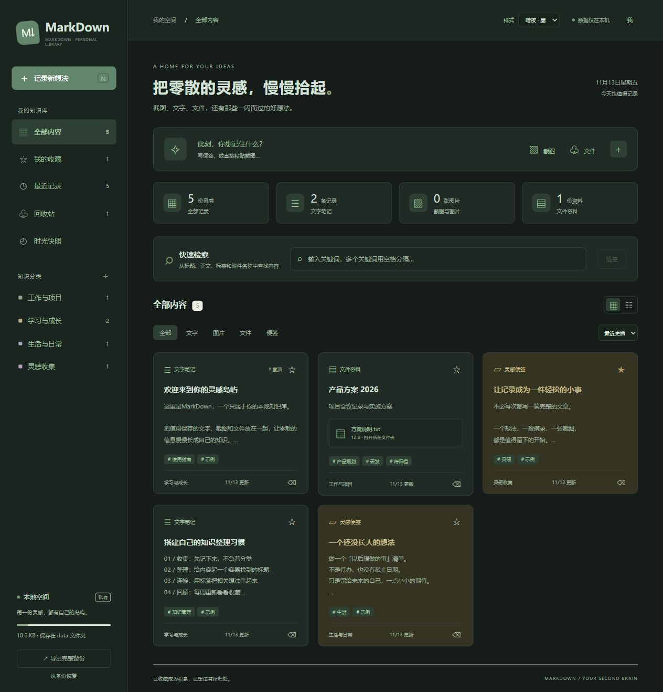
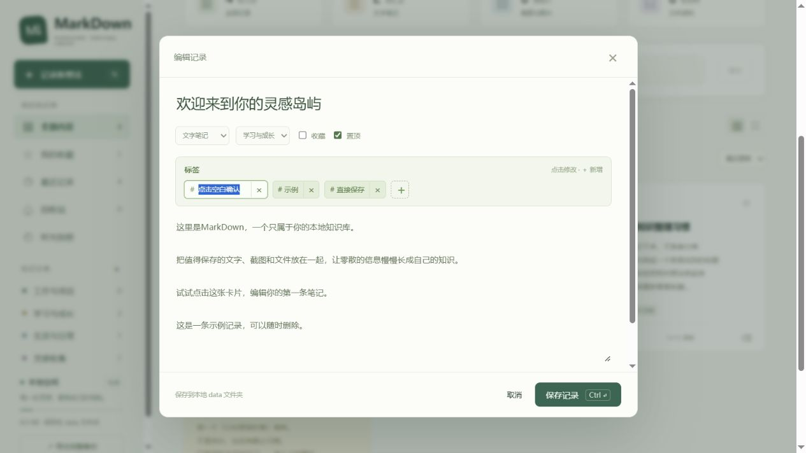

# MarkDown · 本地个人知识库

## 从 GitHub 获取源码后运行

仓库只包含源码、测试和示例效果图，不包含个人笔记、附件、快照、界面偏好、生成的 EXE 或 Node.js 运行时。

1. 下载或克隆仓库，安装 Node.js 18 或以上版本。
2. 双击 `start.cmd`，或在项目目录运行 `node server.js`，访问 `http://localhost:3210`。首次启动会在本地生成 `data`。
3. 需要 EXE 启动器时，在 Windows 上运行 `launcher/build.ps1`；在 `runtime` 放入 Node.js 的 `node.exe` 和对应 `LICENSE` 后，双击生成的 `MarkDown.exe`。

下面的免安装说明适用于包含 EXE 与 runtime 的完整本地文件夹。

## 界面效果

以下为实际页面截图，使用示例资料，不包含个人知识库内容。

### 暗夜样式与快速检索



### 标签原地编辑



用于保存文字笔记、便签、截图和文件。无账号、云服务、外部字体或第三方依赖。服务只监听本机 `127.0.0.1`。

## 启动

双击项目目录内的 **MarkDown.exe**，自动在后台启动本地服务并打开系统默认浏览器；重复双击只打开页面，不会重复启动服务。无需安装 Node.js，项目已包含 `runtime/node.exe` 和对应 LICENSE。不要只移动 EXE，迁移时复制整个项目文件夹。

服务启动后在后台持续运行，关闭浏览器不会停止服务。备用方式：运行 `start.cmd` 查看服务窗口与错误信息；也可以执行 `runtime\node.exe server.js`。

不要直接双击 index.html；浏览器网页通过本地服务把数据写到此文件夹。无需运行 npm install。

## 文件布局与迁移

```
DST/
  index.html / style.css / app.js    网页源码
  server.js / start.cmd             本地服务与备用启动脚本
  MarkDown.exe                      双击启动并打开浏览器
  runtime/node.exe / LICENSE         随附运行时及许可证
  launcher/                         启动器源码与编译脚本
  data/
    library.json                   当前笔记、标签、分类和回收站
    attachments/                   原始附件，以 SHA-256 命名，自动去重
    snapshots/                     最近 20 份历史状态
```

迁移：先停止服务（使用 start.cmd 启动时按 Ctrl+C；EXE 启动的后台服务可在任务管理器中按命令行定位此项目的 runtime\node.exe 后结束），复制整个项目文件夹到另一台电脑。新电脑双击 MarkDown.exe 即可。不要在服务写入时复制 data，以免得到跨时间点的文件组合。`data` 是用户资料，默认被 Git 忽略；通过 Git 迁移源码时须另行复制 data。

## 记录与附件

- 新建笔记、便签，编辑标题、正文和分类；标签末尾点击「＋」原地输入新标签，点击已有标签就在原位置修改，按回车或点击其他位置确认，Esc 取消，× 移除。保存记录时会一并确认正在编辑的标签；留空则取消本次标签编辑。
- 拖入文件、选择文件，或直接粘贴剪贴板截图。保存记录后附件关联才会生效。
- 单个附件上限 30 MB，支持多附件；PNG、JPEG、GIF、WebP 可预览，其他格式下载原文件。
- 收藏、置顶、搜索、类型筛选、分类筛选、标签筛选和列表/卡片视图。
- 统计卡片下方提供快速检索面板，输入即筛选标题、正文、分类、标签及附件名称；多个关键词用空格分隔。普通视图输入时会切回全部内容跨分类检索；回收站内仅检索已删除内容，可一键清空。
- 点击附件名称或文件卡片中的附件区域，在 Windows 资源管理器中打开所在文件夹并选中原始文件，不再弹出浏览器下载。底层附件按内容哈希命名，原文件名显示在网页中。
- `N` 新建，`Ctrl+Enter` 保存。
- 删除先进入回收站；在回收站恢复或永久移除记录。
- 多页面同时修改时，旧版本保存会被拒绝，防止静默覆盖。请保留未保存内容，刷新后重新编辑。

## 快照、完整备份与体积

**快照**：每次保存（包括新增、修改、删除、收藏和分类变动）前，自动保存旧状态；也可手动保存当前状态。最多保留 20 份。快照只含文字、元数据和附件引用，不复制附件，所以体积大约为“笔记文字及索引 × 20”，不会变成“附件总量 × 20”。恢复快照前会另存当前状态。

**完整备份**：左下角导出 `.json.gz` 文件，包含当前资料、最近快照与被它们引用的附件（每个附件仅一份）；可从备份恢复。恢复前会保留当前状态，导入校验附件 SHA-256，损坏的备份不会替换记录。恢复会替换当前记录与分类，不是合并。恢复先在暂存区准备快照，再切换；写入失败时回滚。若进程中断留下恢复标记，下次启动会先回到恢复前的状态。

图片、视频、PDF 和 ZIP 往往已压缩，完整备份仍可能接近附件总量；导出实现使用内存压缩，大资料库建议关闭服务后直接复制整个目录。压缩备份导入限制为 500 MB，解压后最多 750 MB。这两个上限不限制直接复制文件夹迁移。

**空间回收**：永久移除记录不会立即删除底层附件，因为快照可能仍需要它。「时光快照 → 安全清理闲置附件」只删除当前资料、回收站和所有保留快照均未引用的文件；旧快照过期后可再次清理。新上传或重新上传的附件保护 24 小时，打开记录编辑期间每分钟续期；即使另一页面清理，也会跳过受保护附件。关闭或长时间休眠超过 24 小时的未保存编辑不再续期，请及时保存。

本机快照用于撤销误操作，不能防止整块磁盘损坏。重要资料请定期把完整备份或整个目录复制到其他磁盘。内容以普通文件存储，未加密。

## 验证

`node --check server.js`、`node --check app.js` 检查语法。`node tests/smoke.cjs` 在独立临时目录验证去重、快照恢复、备份往返、损坏备份拒绝、版本冲突和清理，不改动当前 data。

启动器源码位于 launcher/Program.cs，可在 Windows 上运行 launcher/build.ps1 重新编译。运行时约 68 MB，只在项目目录中存一份，不包含在笔记快照和页面导出的数据备份中；直接打包整个项目目录时会包含运行时。

界面右上角可选择清新、暖纸、雾蓝、暗夜四种样式，偏好保存在 data/preferences.json，复制整个项目目录时一起迁移。页面导出的压缩资料备份包含记录和附件，不包含界面样式偏好。
